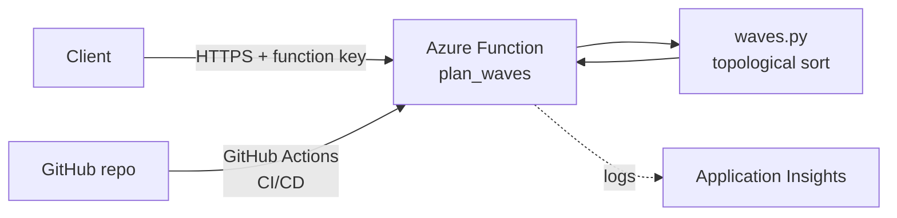

<div align="center">

# 🌊 Migration Wave Planner

**Turn a tangle of application dependencies into an ordered cloud migration plan.**


</div>

---

## 🧭 What is this?

When a company moves applications to the cloud, order matters. A web app can't go first if the API and database it depends on are still on-premises.

This project takes a list of apps and their dependencies and groups them into **migration waves**:

| Wave | Contains | Why |
|------|----------|-----|
| 1 | Apps with no dependencies | Safe to move first |
| 2 | Apps whose dependencies are all in Wave 1 | Their needs are already in the cloud |
| 3+ | And so on | Apps in the same wave can move in parallel |

It uses a **topological sort** (Kahn-style, level by level) and detects **circular dependencies**, which can't be ordered.

---

## ✨ Features

- 📦 **Wave planning**: groups apps into parallel-safe migration waves
- 🔁 **Cycle detection**: returns a clear error naming the apps stuck in a loop
- 🗺️ **Graph output**: returns a Mermaid diagram you can render instantly
- ☁️ **Serverless API**: HTTP-triggered Azure Function, key-protected
- ✅ **Unit tested**: pytest suite covering chains, parallel apps, and cycles

---

## 🚀 API

### `POST /api/plan_waves`

**Request**

```json
{
  "apps": {
    "web": ["orders-api"],
    "orders-api": ["database"],
    "database": []
  }
}
```

**Response `200 OK`**

```json
{
  "waves": [["database"], ["orders-api"], ["web"]],
  "mermaid": "graph LR\n    database --> orders-api\n    orders-api --> web\n    database"
}
```

**Responses**

| Status | Meaning |
|--------|---------|
| `200` | Waves computed successfully |
| `400` | Invalid request body |
| `422` | Circular dependency detected |

**Cycle example**

```json
{ "apps": { "a": ["b"], "b": ["a"] } }
```

returns `422` with `{"error": "Cycle detected among: ['a', 'b']"}`.

### Try it

```powershell
$body = '{"apps": {"web": ["orders-api"], "orders-api": ["database"], "database": []}}'
Invoke-RestMethod -Uri "https://<your-app>.azurewebsites.net/api/plan_waves?code=<function-key>" `
  -Method Post -Body $body -ContentType "application/json"
```

Paste the `mermaid` value into [mermaid.live](https://mermaid.live) to see the dependency graph.

Live demo: `https://<your-app>.azurewebsites.net` *(add after deployment)*

---

## 🏗️ Architecture



### Design decisions

| Choice | Decision | Justification |
|--------|----------|---------------|
| Service model | Azure Functions (PaaS, serverless) | No servers to manage; the workload is short, stateless, and bursty |
| Plan | Consumption | Scales from zero; pay per execution; effectively free at demo scale |
| Region | *Central India* (update if different) | Closest to users, low latency |
| State | None | Each request is self-contained, so it scales horizontally with no database |
| Logic | Separated into `waves.py` | Pure Python, testable without Azure |

---

## 📁 Project structure

```
.
├── function_app.py        # HTTP trigger (Azure Functions v2 model)
├── waves.py               # Topological sort + Mermaid generation
├── tests/
│   └── test_waves.py      # Unit tests
├── conftest.py            # Lets pytest import project modules
├── host.json              # Functions host configuration
├── requirements.txt       # Runtime dependencies
└── requirements-dev.txt   # Test dependencies
```

---

## 💻 Run locally

**Prerequisites:** Python 3.12, [Azure Functions Core Tools v4](https://learn.microsoft.com/azure/azure-functions/functions-run-tools), Git

```powershell
git clone https://github.com/YOUR-USERNAME/migration-wave-planner.git
cd migration-wave-planner

python -m venv .venv
.venv\Scripts\activate
pip install -r requirements.txt

func start
```

The API is then available at `http://localhost:7071/api/plan_waves`. Function keys are not enforced locally.

## 🧪 Run tests

```powershell
pip install -r requirements-dev.txt
pytest
```

---

## 🔐 Security & governance

- [x] Secrets and local config excluded from Git (`local.settings.json`, `.venv`)
- [x] Function-level authorization (API key required once deployed)
- [ ] HTTPS only and minimum TLS 1.2 enforced on the Function App
- [ ] Keyless GitHub to Azure login using OIDC (no stored passwords)
- [ ] Deployment identity limited to the project resource group (least privilege)
- [ ] Managed Identity and Key Vault if any secret is introduced

## 💰 Cost awareness & cleanup

- Consumption plan: pay per execution, with a monthly free grant
- One resource group holds everything, so cleanup is a single command
- Budget alert configured in Azure Cost Management *(add details)*

**Tear everything down:**

```bash
az group delete --name <resource-group-name> --yes --no-wait
```

---

## 🔄 CI/CD

GitHub Actions workflow: run tests, then deploy to Azure on every push to `main`. *(Workflow coming in `.github/workflows/`.)*

---

<div align="center">

Built as a cloud migration planning demo on Azure ☁️

</div>
